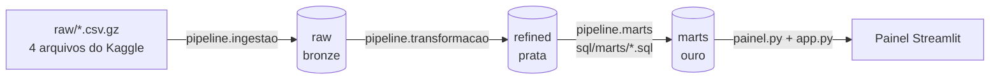

# Brasileirão em números

Pipeline de dados em Python sobre o Campeonato Brasileiro de Futebol, Série A
de 2003 a 2025: do CSV bruto a um painel interativo, passando por três
camadas num banco DuckDB.

## Objetivo

Projeto final da trilha de **Engenheiro de Dados Jr** da Pós em Engenharia de
Dados e IA, para a passagem a **pleno**.

O projeto mostra, ponta a ponta, o trabalho de um engenheiro de dados:

- ingerir um dataset público sem perder nenhuma informação;
- tipar e limpar o dado com regras explícitas, que param o pipeline em vez de
  esconder o erro;
- modelar perguntas de negócio em SQL versionado, com o grão de cada tabela
  declarado;
- entregar um painel que só exibe números calculados no banco;
- cobrir tudo com testes automatizados que rodam em qualquer máquina.

Todo o desenvolvimento seguiu **spec-driven development**: cada etapa nasceu
de uma especificação escrita (pasta `SDD/`), e o código é consequência dela.
A spec de cada módulo está na docstring do topo do arquivo, com o motivo de
cada regra.

## Tecnologias utilizadas

| Tecnologia | Uso |
|---|---|
| Python 3.13 | linguagem do pipeline e do painel |
| [uv](https://docs.astral.sh/uv/) | ambiente virtual, dependências e execução |
| DuckDB 2.0 | banco analítico em arquivo único (`brasileirao.duckdb`) |
| pandas 3 | leitura dos CSV na ingestão |
| SQL | regras de negócio da camada de marts |
| Streamlit | painel web |
| Plotly | gráficos do painel |
| pytest + pytest-cov | testes unitários e cobertura |
| Ruff | lint e formatação |

## Arquitetura em camadas (medallion)



As três camadas são schemas do mesmo arquivo `brasileirao.duckdb`.

| Camada | Schema | Conteúdo | Regra central |
|---|---|---|---|
| Bronze | `raw` | `partidas`, `estatisticas`, `gols`, `cartoes`, exatamente como chegaram | nenhuma conversão, nenhum descarte: tudo VARCHAR |
| Prata | `refined` | as mesmas quatro tabelas, com tipos e nomes em português | conversão que falha para tudo; nada vira nulo em silêncio |
| Ouro | `marts` | 14 tabelas, uma por pergunta de negócio | cada tabela é um único SELECT num arquivo `.sql` |

## Estrutura do projeto

```
pipeline_brasileirao/
├── raw/                         # dados de origem (.csv.gz) e Legenda.txt
├── pipeline/
│   ├── db.py                    # conexão e gravação, compartilhadas pelas etapas
│   ├── ingestao.py              # etapa 1: CSV -> raw
│   ├── transformacao.py         # etapa 2: raw -> refined
│   └── marts.py                 # etapa 3: executa sql/marts/ -> marts
├── sql/marts/                   # 14 arquivos NN_nome.sql, um por mart
├── painel.py                    # leitura, formato, identidade dos clubes e gráficos
├── app.py                       # página do Streamlit
├── .streamlit/config.toml       # tema escuro verde e amarelo
├── test/                        # um arquivo de teste por módulo
├── SDD/                         # specs de cada etapa
├── ui.py                        # abre o banco na interface web do DuckDB
├── pyproject.toml               # dependências, pytest e coverage
└── LICENSE                      # licença dos dados
```

O arquivo `brasileirao.duckdb` é gerado pelo pipeline e fica na raiz.

## Como usar

Pré-requisito: [uv](https://docs.astral.sh/uv/getting-started/installation/)
instalado. O uv baixa o Python 3.13 se ele não estiver na máquina.

```bash
# 1. Instalar as dependências (inclui as de desenvolvimento)
uv sync

# 2. Rodar o pipeline, nesta ordem
uv run python -m pipeline.ingestao       # raw/*.csv.gz -> schema raw
uv run python -m pipeline.transformacao  # raw -> refined
uv run python -m pipeline.marts          # refined -> marts

# 3. Abrir o painel (http://localhost:8501)
uv run streamlit run app.py
```

Cada etapa imprime uma linha por tabela, com a contagem lida do banco, e
encerra com erro se a etapa anterior não tiver rodado.

O painel abre na **Visão geral**, com três abas: Campeonato, Temporada e
Jogadores. Pela barra lateral, escolha um dos 46 clubes para ver a página
dele. Depois de rodar `pipeline.marts` com o painel aberto, use o botão
**Recarregar dados**.

Para explorar o banco no navegador:

```bash
uv run python ui.py   # Ctrl+C para encerrar
```

> O arquivo `.duckdb` aceita um único processo escrevendo. Com o `ui.py` de
> pé, as etapas do pipeline falham com erro de lock. O painel não tem esse
> problema: ele abre o banco só para leitura e fecha a conexão a cada leitura.

Para adicionar um mart, crie `sql/marts/NN_nome.sql` com um único SELECT e
rode `pipeline.marts` de novo. A tabela `marts.nome` é criada sem mudar
nenhuma linha de Python.

## Regras

### Ingestão (raw)

- Lê só os quatro arquivos do mapa, pelo nome; qualquer outro arquivo da
  pasta é ignorado.
- Toda coluna entra como texto, com a inferência de tipo desligada. Os nomes
  das colunas ficam como no cabeçalho, inclusive `rodata` e `mandante_Placar`.
- Só o campo vazio vira nulo. O texto `'None'` continua texto, para a etapa
  seguinte poder separá-lo do vazio.
- Faltando qualquer um dos quatro arquivos, nada é ingerido.

### Transformação (refined)

- Colunas renomeadas para português, em snake_case, por um mapa completo
  (`rodata` → `rodada`, `ID` → `partida_id`).
- Tipos declarados:
  - `data` vira DATE, com o formato `dd/mm/aaaa` declarado;
  - `arrecadacao` vira DECIMAL(10,2), porque é dinheiro;
  - posse `'58%'` vira 58;
  - minuto `'90+5'` vira duas colunas, `minuto` 90 e `acrescimo` 5.
- Cada valor passa por uma checagem de formato (regex) antes de converter. Um
  valor fora do formato para o pipeline e mostra tabela, coluna e exemplo,
  em vez de virar nulo.
- Duplicata exata em `partidas` e `estatisticas` sai. Em `gols` e `cartoes`
  a linha repetida fica, porque o mesmo atleta pode marcar duas vezes no
  mesmo minuto.
- Anomalias de negócio ficam como chegaram. Quem decide o que fazer com elas
  é o mart que responde a pergunta.
- As quatro tabelas são gravadas numa única transação.

### Marts

- Cada arquivo `NN_nome.sql` vira a tabela `marts.nome`.
- O schema `marts` é apagado e recriado a cada execução, numa única
  transação. Um mart cujo arquivo foi apagado some do banco.
- Se um `.sql` falhar ou um mart voltar vazio, o schema volta a ser o da
  última execução que deu certo.

### Painel

- Nenhum cálculo em Python: o painel só lê, ordena, filtra, renomeia e
  formata. Número novo na tela exige um `.sql` novo em `sql/marts/`.
- Formato brasileiro sempre (`23.474`, `49,6%`, `R$ 518.065.218,68`), sem
  depender do locale da máquina.
- Sem logos oficiais nem escudos, que são marcas registradas. Cada clube é
  representado por um bloco com sigla e cores tradicionais, feito em HTML/CSS.

## Definições de negócio

| Conceito | Definição |
|---|---|
| Temporada | `year(data - 2 meses)`: jogos de janeiro e fevereiro contam na temporada anterior (a de 2020 terminou em fevereiro de 2021) |
| Pontos | vitória 3, empate 1, derrota 0, contados pelo placar; punições do tribunal não estão no dado |
| Desempate | pontos, vitórias, saldo e gols pró; empate em tudo divide a posição |
| Campeão | 1.º colocado da temporada pelos critérios acima |
| Aproveitamento | pontos ganhos sobre pontos disputados (3 por jogo), somados no período todo antes de dividir |
| Artilharia | gol contra fica fora: não é gol do atleta que aparece na linha |
| Gols nos acréscimos | faixas `45+` e `90+`, separadas das faixas do minuto 45 e 90 |
| Cobertura do dado | gols por atleta desde 2014; cartões de 2014 a 2024; arrecadação só em 2025 |

Os 14 marts e a pergunta que cada um responde:

| Mart | Pergunta |
|---|---|
| 01 `gols_por_temporada` | Quantos gols saem por temporada? |
| 02 `artilheiros` | Quem mais fez gols? |
| 03 `mando_de_campo` | Jogar em casa ajuda? |
| 04 `classificacao` | Qual a classificação de cada temporada? |
| 05 `gols_por_partida` | Quantos gols costuma ter uma partida? |
| 06 `aproveitamento_por_clube` | Qual o aproveitamento de cada clube em todas as temporadas que jogou? |
| 07 `cartoes_por_posicao` | Que posição leva mais cartão? |
| 08 `posse_e_resultado` | Quem fica mais com a bola vence mais? |
| 09 `arrecadacao_pareto` | Que fração dos clubes faz 80% da arrecadação? |
| 10 `partidas_por_dia_da_semana` | Em que dia da semana se joga, e em qual saem mais gols? |
| 11 `titulos_por_clube` | Quem mais ganhou o Brasileirão? |
| 12 `kpis` | Os números dos cartões do painel |
| 13 `gols_por_minuto` | Em que momento do jogo saem os gols? |
| 14 `artilheiros_por_clube` | Quem mais fez gols por cada clube? |

O grão e as regras de cada mart estão nos comentários do topo do arquivo
`.sql` correspondente.

## Testes

```bash
uv run pytest --cov
```

São 70 testes unitários, um arquivo por módulo em `test/`, com cobertura de
**98%** do código medido (a meta configurada é 60%). Ficam fora da medição o
`app.py`, que é layout e é conferido no navegador, e o `ui.py`.

Os testes seguem três princípios:

- **Nunca o banco nem os dados do projeto.** Cada teste cria um DuckDB novo
  numa pasta temporária, com poucas linhas inventadas. A suíte roda sem o
  pipeline ter rodado e não altera o banco de ninguém.
- **Resultado da regra, não do dado.** Cada linha de entrada tem um
  comentário dizendo por que está ali (gol aos 90+5, posse `'None'`, jogo em
  fevereiro, gol contra). O valor esperado sai da conta sobre essa entrada,
  nunca de um número medido no dado real.
- **DuckDB de verdade, sem mock.** O nome de cada teste é a frase que ele
  prova, por exemplo `test_gol_contra_fica_fora_do_artilheiro`.

## Origem e licença

Dados públicos de Adão Duque, via Kaggle:
[Campeonato Brasileiro de Futebol](https://www.kaggle.com/datasets/adaoduque/campeonato-brasileiro-de-futebol).
Redistribuídos aqui comprimidos, sem alteração de conteúdo, sob
[GPL-2.0](https://www.gnu.org/licenses/old-licenses/gpl-2.0.html). Veja
[LICENSE](LICENSE).
